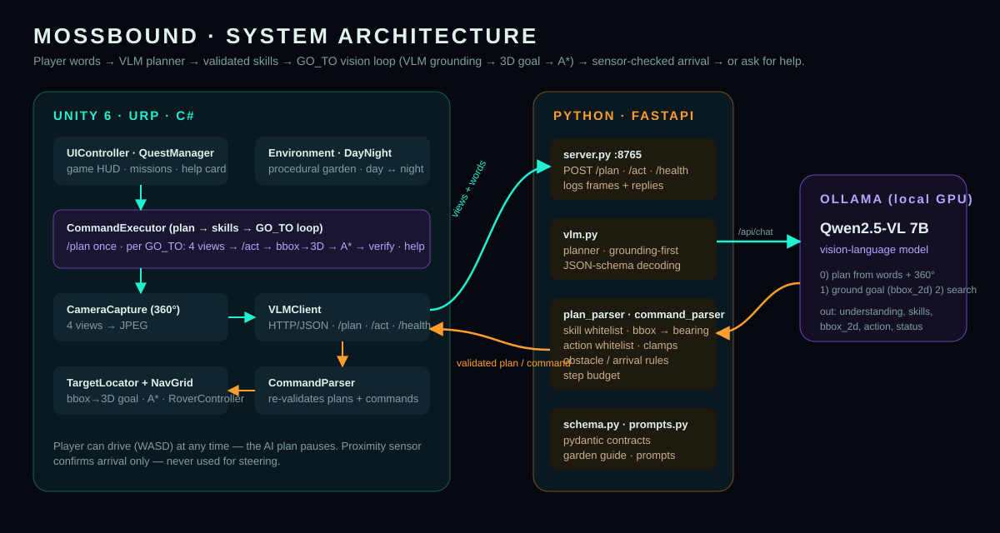

# MOSSBOUND

**A small game in Unity: you talk to MOSS, a cute garden rover controlled by a real vision-language model, and help it complete a mission in a whimsical garden that shifts between night and day.**

Each run gives MOSS a **mission**: *Snack Time*, *Dance Party*, *Falling Stars*, *The Magic Gate* or *Morning Tour*. Objectives are plain and short (*"Pick a golden apple at the Big Tree"*) and name things by the signs floating over them in the garden: **Big Tree, Pond, Mushrooms, Crystal, Red Flower, Magic Gate, Home**. You complete them by telling MOSS what to do in your own words, or by driving it yourself. If MOSS isn't sure what you mean, it **asks you first** ("Do you mean the Red Flower?"). If it gets stuck, it asks for help. While it drives, **MOSS's Eyes** shows the objects the AI is detecting in front of it, and labels float over them in the garden.

For every command, MOSS:

1. Looks around with four cameras.
2. Sends what it sees plus your words to a **local vision-language model** (Qwen2.5-VL 7B via Ollama).
3. Gets back a validated **plan** of skills, such as `GO_TO`, `MOVE`, `TURN` or `DANCE`, together with a one-sentence explanation of how it understood you.
4. If the planner is unsure what you meant, MOSS asks, offering YES (its guess) plus other options, before it moves.
5. For each `GO_TO`, finds the goal in its camera images, projects the model's bounding box into the 3D world, plans a path and drives there, labelling what it sees on the way.
6. Confirms that it really arrived before celebrating.

No movement is scripted or keyword-matched. Every goal MOSS drives to is located by the model in rendered pixels.



---

## 1. Quick start

1. **Start the AI backend first** (before Unity). Double-click `start_backend.bat` and keep the window open. Wait for `model ready - 100% of it on the GPU` and `Uvicorn running on http://127.0.0.1:8765`. Loading the model before Unity matters: if Unity takes the GPU memory first, the model can end up on the CPU and replies get 10-20x slower (the HUD then shows a **SLOW BRAIN** warning).
2. **Open the Unity project.** In Unity Hub, add `MossboundUnity` and open it with Unity 6 (tested with 6000.6.8f1).
3. **Press ▶ Play.** Any scene works, because everything is generated in code.
4. Read the mission card, then press **START MISSION** (or Enter).
5. Talk to MOSS: press **Enter**, type anything, then press **Enter** again. Or drive it with **WASD**.

The top-right pill should read **BRAIN ONLINE · QWEN2.5VL:7B · GPU** (green dot). Close other GPU-heavy apps for the fastest replies; the model shares your GPU.

**Controls**

| Key | Action |
|---|---|
| **WASD / arrows** | Drive MOSS yourself, at any time. If MOSS is busy, it hands you the wheel and **carries on from where you left it** about a second after you let go. Shift = faster. |
| **Space** | Hop |
| **Enter** | Talk to MOSS (focus the command bar); Enter again sends |
| **N** or the DAY/NIGHT button | Smooth day ↔ night transition |
| **Tab** or the BRAIN button | Show or hide *MOSS's Brain*, the panel with exactly what the AI saw, understood, planned and decided |
| **R** | Try again, after MOSS asked for help |
| Question buttons | When MOSS double-checks: **YES** runs its guess, an option asks again with that choice, **NO** lets you rephrase (typing "yes" also works) |
| Quick chips | Example commands for the current objective, plus "What should we do?", "Dance!", "Come home" |
| **Esc** | Stop the current plan |
| **Click MOSS** | It reacts |
| Right-drag / scroll | Orbit / zoom the camera |

**Things to say** (all verified with the real model, see §5)

| You say | What MOSS does |
|---|---|
| `I'm hungry` | "You're hungry, and the only food here is the golden apples on the Big Tree, so I'll go there." → GO_TO Big Tree |
| `share it with the mushrooms` / `give the apple to my bouncy friends` | GO_TO Mushrooms |
| `I'm thirsty` | GO_TO Pond |
| `go to the red flower and dance` | GO_TO Red Flower, DANCE |
| `take us somewhere bouncy` / `show our visitor the prettiest thing` | GO_TO Mushrooms / Red Flower |
| `go to the crystal then the magic gate` | GO_TO, GO_TO |
| `spin around` / `spin and dance` | TURN 360 (+ DANCE) |
| `go there` / `the thing over there` | **asks**: "Do you mean the Red Flower?" [YES] [Go to the Pond] [NO] |
| `what should we do?` / `what's next?` | **asks**: "Next we pick a golden apple at the Big Tree. Shall we go?" → YES drives there |
| `hi moss` | SAY (no movement) |

---

## 2. Installation (fresh machine)

| Requirement | Tested version | Notes |
|---|---|---|
| Windows 10/11 | 11 | |
| NVIDIA GPU, ≥ 8 GB VRAM recommended | RTX 5060 Laptop 8 GB | CPU-only works but is very slow |
| Unity Hub + Unity 6 (URP) | 6000.6.8f1 | free Personal licence |
| Python | 3.14 (3.10+ fine) | |
| Ollama | 0.40.16 | local model runtime |

```bash
winget install Ollama.Ollama
```
```bash
ollama pull qwen2.5vl:7b
```
```bash
pip install -r backend/requirements.txt
```

No API keys or internet connection are needed at runtime. With less VRAM, run `ollama pull qwen2.5vl:3b` and `set MOSS_MODEL=qwen2.5vl:3b`.

---

## 3. How it works

### How MOSS decides where to go (e.g. "I'm hungry")

There is **no phrase → target table**. The planner prompt gives the model *world knowledge*, the kind a player would read in a game's guide: what each thing in the garden **is** and **what it is good for**. For example: *"the Big Tree... golden apples grow on it - the only food in the garden"*, or *"the Pond, the only water to drink"*. Positions are never given. The model then reasons from your words to a goal and must explain itself in one sentence (`understanding`). That sentence is shown in the dialogue log and in *MOSS's Brain*:

> **You:** I'm hungry
> **MOSS understood:** You're hungry, and the only food here is the golden apples on the Big Tree, so I'll go there.

So any wording works ("I could eat something", "snack time?"), as long as the model can connect it to what things are for. In *Snack Time*, MOSS then picks a golden apple, which circles its head while it carries it.

**When it isn't sure,** the planner sets `unsure: true`: MOSS asks a short question and waits. **YES** runs the plan it already made (no second AI call); an option button or anything you type goes back to the planner with the question as context. The floating name signs are on a layer MOSS's cameras never render, so the AI still has to recognise everything by sight.

### Pipeline

```
 Player: "now share it with my glowing bouncy friends"
   |
 [0] PLAN  (once per command)  POST /plan
       4 camera views (2x2 mosaic) + words + time of day + what MOSS carries (+ mission text if asked about)
       -> VLM -> {understanding, unsure, reply, options, steps:[{request, skill, target, description, view, amount}]}
       -> unsure? MOSS asks first (YES / options / NO) and waits
       -> plan_parser: skill whitelist, amounts clamped, landmark synonyms snapped, padding steps dropped
       -> Unity re-validates (CommandParser.ValidatePlan)
   |
 [1] ACT   each skill -> bounded motion
       MOVE / TURN / LOOK_AROUND / DANCE / COME_BACK / SAY / STOP  -> RoverController primitives
       GO_TO -> closed vision loop (<= 8 looks):
           4 views -> POST /act
               grounding first: Qwen2.5-VL native {"bbox_2d"} in the planner's view, then the other views
               not found -> reasoning pass over the mosaic decides how to search (or that it can't exist)
           -> bbox -> TargetLocator: 3x3 rays from the exact capture pose -> 3D goal
           -> NavGrid A* around obstacles and the pond -> drive (<= 20 s leg), beacon + trail show the goal
           -> arrived?  known landmark: the proximity sensor must confirm (no extra VLM call)
                        otherwise: look again; repeated "arrivals" at a wrong spot = look-alike, ignored
           while driving (GPU otherwise idle): POST /detect on the FRONT camera every few seconds
               -> Qwen2.5-VL multi-object grounding -> labelled boxes in MOSS'S EYES + labels over the objects in 3D
   |
 [*] SHARE the player presses WASD at any moment -> MOSS halts and hands over the wheel;
           ~1 s after the keys are released it looks again from the new spot and carries on with the same plan
   |
 [2] HELP  stuck twice / not found after 4 searches / only look-alikes / out of looks
       -> MOSS stops, says why, and the HELP card appears:
          drive it with WASD then RETRY (R), or type a hint (sent to the planner with the help context)
```

**Why a planner pass?** With only the per-step navigation prompt, MOSS understood a fixed set of goal phrasings. The planner lets the same VLM handle anything: questions, chit-chat, relative motion ("back up a little"), multi-part requests, feelings and mission talk. It also produces a visible explanation. It is the same model (8 GB VRAM can't hold a second one without swapping), with its own prompt and schema.

**Why grounding first?** Qwen2.5-VL's native grounding prompt is fast (~1–1.5 s per view) and accurate on a single full-resolution view. The slower reasoning pass (~4 s) is only needed when the goal isn't found anywhere. A typical GO_TO now takes **one** look plus driving.

### Unity modules (`MossboundUnity/Assets/Mossbound/Scripts`)

| Module | Responsibility |
|---|---|
| `MossboundApp` | Entry point; builds everything on Play; GPU-friendly frame cap (60 fps, 15 fps while the VLM thinks) |
| `Agent/CommandExecutor` | Plan → (ask if unsure) → skills → GO_TO vision loop → arrival checks; player takeover and resume; live detection loop; ask for help / retry |
| `Agent/RoverController` | MOSS: cute procedural model (blinking eyes, gaze, cheeks, sprout, antenna), speech bubble, hop/spin/dance, carried items, help mode; motion primitives, A* path following, sensors; player driving |
| `Agent/CameraCapture` | 360° vision: 4 views rendered on demand, poses remembered for projection |
| `Agent/GoalMarker`, `Agent/PortraitCam` | Goal beacon and trail (hidden from MOSS's own cameras); live face portrait for the dialogue box |
| `AI/TargetLocator` | VLM bbox → 3D goal (centre-weighted ray grid); physical arrival check |
| `AI/VLMClient` | HTTP client (`/plan`, `/act`, `/detect`, `/health`) |
| `AI/CommandParser` | Client-side whitelist and clamps for commands **and** plans |
| `Game/QuestManager` | 5 missions with plain objectives (some any-order, some "dance there"), visible stars and key, carried items, chips' example commands, stars, timer, stats |
| `World/EnvironmentController` | Procedural garden on gently rolling ground: Big Tree, Pond, Mushrooms, one Crystal, Red Flower, Magic Gate, Home pad, small trees, lanterns, wisps, particles, and player-only floating name signs |
| `World/DayNight` | Day ↔ night: sun/moon, ambient, fog, sky, glow dimming, post-FX, lamp intensities (procedural day sky with clouds) |
| `World/Whimsy`, `World/NavGrid`, `World/Landmark` | Night sky and animation components; occupancy grid + A*; named points of interest (used **only** by the proximity sensor and the mission referee) |
| `UI/UIController`, `UI/UIKit` | Game HUD: start screen, mission card with progress stars, chat bubbles, MOSS's Eyes (live detections), floating labels in 3D, dialogue with portrait, question buttons, objective chips, takeover banner, GPU warning, help card, confetti, complete screen, detailed Brain panel (Tab) |
| `Editor/MossboundEditor` | Batch tools: HUD/world previews, full mission tests against the real VLM |

### Backend (`backend/`)

| File | Responsibility |
|---|---|
| `server.py` | FastAPI: `POST /plan`, `POST /act` (grounding-first), `POST /detect`, `GET /health` (incl. how much of the model is on the GPU), `GET /` (last frame the VLM saw); logs `plans.jsonl`, `requests.jsonl`, the last 40 frames |
| `vlm.py` | Ollama client: mosaic builder, planner call (half-size mosaic, ~2.5 s), reasoning pass, grounding pass, multi-object detection, GPU status, model kept loaded |
| `prompts.py` | Garden guide (what things are and are good for), planner prompt, navigation prompt |
| `plan_parser.py` | Plan validation: skill whitelist, clamps, synonym snapping, padding guard, question/YES-plan consistency |
| `command_parser.py` | Navigation-command validation, bbox → view and bearing, rule layer, hard limits |
| `schema.py` | Pydantic contracts and the JSON schemas the model is forced to follow |

### Plan format (forced by an Ollama JSON schema, then validated)

```json
{ "understanding": "You're hungry, and the only food here is the golden apples on the Big Tree, so I'll go there.",
  "unsure": false,
  "reply": "Golden apples await! Let's go to the Big Tree.",
  "options": [],
  "steps": [ { "request": "I'm hungry", "skill": "GO_TO", "target": "largest_tree",
               "description": "giant tree with a turquoise canopy", "view": "FRONT", "amount": 0 } ] }
```

Skills: `GO_TO`, `MOVE` (m, ±10), `TURN` (°, ±360), `LOOK_AROUND`, `DANCE`, `COME_BACK`, `SAY`, `STOP`; at most 4 steps.
Navigation actions (`/act`): `MOVE_TO_TARGET`, `MOVE_FORWARD`, `MOVE_BACKWARD`, `TURN_LEFT`, `TURN_RIGHT`, `STOP`.

### Safety and validation layers

1. **Constrained decoding:** enums for skills, actions, statuses and views.
2. **Backend validation:**
   - Unknown skills are dropped.
   - Moves are clamped to ±10 m, turns to ±360°, navigation legs to 20 s, and speed to 3 m/s.
   - Boxes that cover the whole view are rejected.
   - "Arrived" claims that can't be verified become "keep exploring".
   - The step budget is enforced.
3. **Unity re-validation** of every plan and command.
4. **Physical truth:**
   - A landmark only counts as reached when the proximity sensor confirms it.
   - Look-alike spots are remembered and ignored.
   - The goal beacon is invisible to MOSS's own cameras, so it can't "see" its own label.
5. **Motion constraints:**
   - Collisions, an invisible water barrier and a garden boundary.
   - A* paths for every drive, including "go forward N m".
   - A front and rear "never ram" sensor.
   - Stuck detection.
   - Every motion is time-bounded.
6. **The player can always take over** with the keyboard; MOSS pauses and resumes when they let go.

**What the AI is *not* given:** positions or directions of anything. The planner gets the garden guide (what things are), the camera images, the time of day, what MOSS is carrying, the proximity sensor (what is right next to it), and the mission text only when you ask about the mission. The navigation step adds the obstacle flag and a short history.

---

## 4. Testing without Play mode

```bash
powershell -File tools/unity_batch.ps1 mission "I'm hungry || share it with the mushrooms || I'm thirsty" snack -quest 0
```
Builds the whole game headlessly in a private copy of the project (it works while the editor is open). It then sends each command (`||`-separated) through the **same executor code** the game uses, against the real VLM, and prints the plan, every perception step, the outcome and the mission progress.

- `-day 1`: test in daylight.
- `-start x,z,yaw`: start position.
- `DRIVE x,z` (a step): simulate the player driving.
- `RETRY` (a step): press Try again.
- `YES` (a step): press YES on MOSS's question.

```bash
powershell -File tools/unity_batch.ps1 preview
```
Renders the world, a portrait of MOSS, and the HUD (start screen, in-game with detections, question card, help card) into `docs/screenshots/`; add `-day 1` for daytime.

**DEV MODE:** `start_backend_mock.bat` runs the backend with scripted replies and no model. The HUD clearly shows "MOCK BACKEND · DEV MODE (no AI)".

---

## 5. Verified results (Qwen2.5-VL 7B, RTX 5060 8 GB, batch mode, model 100% on GPU)

| Mission (time) | Commands typed | Result |
|---|---|---|
| Snack Time (night) | "I'm hungry" · "share it with the mushrooms" · "I'm thirsty" | **complete**: 6 s, 12 s, 5 s |
| The Magic Gate (night) | "go to the pond" · "take the key to the magic gate" · "do a happy dance" | **complete**: 17 s, 5 s, 3 s |
| Dance Party (night) | "go to the crystal" · "go to the red flower and dance" · "go home" | **complete**: 6 s, 6 s, 3 s |
| Falling Stars (night) | "what should we do?" → YES · "what's next?" → YES · "what now?" → YES | **complete**, driven only by MOSS's suggestions |
| Morning Tour (day) | "show our visitor the prettiest thing" · "take us somewhere bouncy" · "what's next?" · "go home" | **complete** |
| Planner alone | "go there", "the thing over there" → asks; "spin around" → TURN 360; "give the apple to my bouncy friends" → Mushrooms | correct, ~2.5 s each |
| Live detection | front camera at the mushroom grove → six "Mushroom" boxes on the right spots | 3.5-5 s per detection (runs while driving) |

Times are wall-clock per command (planning about 2.5 s, plus vision and driving at full speed in the headless test). In Play mode, the driving itself takes real time (3 m/s).

**Not verified automatically:** anything needing a real keyboard or mouse in Play mode (taking the wheel mid-command and resuming, clicking the question buttons, live detection labels while driving, confetti and animations). That code compiles and shares the tested executor paths, but has only been checked by reading it and in screenshots.

Problems found and fixed in this round:
- **Very slow replies in Play mode (25-78 s):** the model had been unloaded after 60 idle minutes, then reloaded while Unity held most of the GPU memory, so it ran on the CPU. Now the model stays loaded while the backend runs, `/health` reports the GPU share, and the HUD warns when it drops below 100%.
- The planner chose the thing MOSS was standing next to ("share it with the mushrooms" → Big Tree) and padded plans ("spin and dance" lost its DANCE).
- MOSS's question and its YES plan could disagree; a prompt example was copied into replies word for word.
- Three similar crystals and riddle objectives ("the warm orange key shard") confused both players and the AI. Now there is one Crystal, objectives use the sign names, and the key and stars are visible glowing objects.

Earlier rounds fixed: MOSS's cameras seeing its own goal label, the pond's safety wall catching grounding rays, look-alike mushrooms and teal trees, and the too-thin flower.

---

## 6. Troubleshooting

| Symptom | Fix |
|---|---|
| **BRAIN OFFLINE** | Run `start_backend.bat`; check http://127.0.0.1:8765/health |
| **OLLAMA NOT RUNNING** / **MODEL NOT INSTALLED** | Start Ollama / `ollama pull qwen2.5vl:7b` |
| **SLOW BRAIN** banner / slow replies | Part of the model is on the CPU. Close Unity, restart the backend (and Ollama, or the PC if `nvidia-smi` fails), start the backend **before** Unity. `ollama ps` should show `100% GPU` |
| Unity batch tools say "No valid Unity Editor license" | Open Unity Hub and sign in, then retry |
| WASD doesn't drive | The command bar has focus. Press Esc (or click the world) first |
| MOSS picks the wrong thing | Say it differently or more concretely ("the golden ring portal"), or drive closer. Open *MOSS's Brain* (Tab) to see its box, or http://127.0.0.1:8765/ for the exact image; logs are in `backend/logs/` |
| "Insecure connection not allowed" | Handled by the editor script; otherwise set Player → *Allow downloads over HTTP* to Always |

---

## 7. Features, limitations and future work

**Implemented**
- **Game layer:** start screen, five missions with plain objectives (some any-order, some "dance there"), visible stars and golden key, carried items, timer, ★ rating, free play.
- **Open-ended language:** a VLM planner turns anything into a short skill plan with a visible explanation.
- **Double-checking:** when unsure, MOSS asks with YES / option / NO buttons before moving; mission questions get "Shall we go?".
- **Real vision control:** 360° grounding, bbox → 3D goal, A* navigation, sensor-confirmed arrival, look-alike memory.
- **Live "what MOSS sees":** VLM detections boxed in MOSS's Eyes and labelled over the real objects in 3D.
- **Shared control:** drive with WASD any time; MOSS hands over the wheel and resumes the same plan when you let go.
- **Ask for help** when stuck, with Try again or a typed hint.
- **Day ↔ night** with glow dimming; the time of day is passed to the VLM.
- **Playful HUD:** chat bubbles, live portrait with mood ring, objective chips, confetti, pop-in cards, and floating name signs that only the player sees.
- **Speed:** model kept loaded on the GPU, half-size planner image (~2.5 s plans), grounding-first navigation, GPU health warning.

**Limitations**
- The 7B model on a laptop GPU needs about 2.5 s to plan and about 1.5 s per grounding look (about 4 s more when it has to reason about searching). MOSS thinks, then moves.
- The Unity editor and the model share 8 GB of GPU memory; starting Unity first can push the model to the CPU (the HUD warns).
- Look-alikes still cost extra looks sometimes, for example small glowing things grounded as "golden ring". The sensor check and look-alike memory stop wrong arrivals, but not wasted time.
- Mission objectives are refereed by proximity to landmarks (game logic). Arrival at a *landmark* is confirmed the same way; the AI decides only where to go.
- Tested in the Editor (batch mode for the AI runs); a standalone build may need URP shader variants included.

**Future improvements**
- Overlap inference with motion; stream plan steps.
- A bigger model or a hosted VLM behind `vlm.py` for even better language understanding.
- A spatial memory of seen landmarks, so MOSS remembers where things were.
- Voice input; sound effects and music; more missions.
